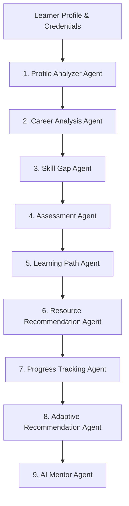

# SkillPath AI — Autonomous Adaptive Learning Platform

> **"Learn only what you need before learning what you want."**

**SkillPath AI** is a complete, production-grade, full-stack educational technology platform engineered to help learners transition into target careers through autonomous prerequisite diagnostics, adaptive curriculum sequencing, skill-gap analysis, and multi-agent AI collaboration.

---

## 🌟 Core Innovation

Traditional online learning forces all students through rigid, monolithic courses regardless of unaddressed prerequisite gaps. When a student struggles with foundational JavaScript (like functions, closures, or DOM bubbling), they fail React and abandon the career path entirely.

**SkillPath AI** enforces a fundamental pedagogical rule:
1. When a learner enrolls in a target course (e.g. *React Developer Path*), the platform first maps the required prerequisite competencies (HTML, CSS, JavaScript fundamentals, Functions, Arrays, Objects, DOM, and ES6+).
2. The learner completes a **Prerequisite Diagnostic Assessment**.
3. If the learner performs poorly in foundational topics (<50% score), the **Adaptive Recommendation Agent**:
   - Classifies the status as **Foundation Required**.
   - Locks the advanced course modules.
   - Dynamically injects free, targeted foundation tutorials and remedial exercises directly into the roadmap.
   - Enforces a reassessment gatekeeper.
4. When the learner reviews the targeted tutorials and retakes the diagnostic with an improved score (≥75%), the system automatically certifies them as **Ready**, skips obsolete introductory modules, and unlocks the main course.

---

## 🏗️ Multi-Agent AI Architecture

The system features **9 specialized AI agents** orchestrated by a central pipeline service (`AgentOrchestrator`):



| Agent Name | Role | Primary Responsibility |
| :--- | :--- | :--- |
| **1. Profile Analyzer Agent** | Learner Skill Normalization | Extracts and normalizes declared skills, analyzes certifications and projects, and calculates baseline study velocity. |
| **2. Career Analysis Agent** | Target Career Breakdown | Deconstructs target market roles into competency graphs and assigns prerequisite dependencies. |
| **3. Skill Gap Agent** | Deficiency & Readiness Scoring | Compares learner mastery against target standards; prioritizes critical, high, and medium gaps. |
| **4. Assessment Agent** | Diagnostic Evaluation | Evaluates diagnostic submissions, computes topic-level breakdowns, and classifies readiness into Ready, Needs Revision, or Foundation Required. |
| **5. Learning Path Agent** | Roadmap Sequencing | Synthesizes an 8-stage progressive roadmap respecting prerequisite constraints. |
| **6. Resource Recommendation Agent** | Resource Curation & Tiering | Prioritizes free high-yield tutorials (MDN, freeCodeCamp) first, reserving paid masterclasses for advanced subscribers. |
| **7. Progress Tracking Agent** | Milestone & Activity Logging | Credits study hours, detects improvement velocity, updates verified skill scores, and sustains streaks. |
| **8. Adaptive Recommendation Agent** | Dynamic Curriculum Adaptation | Dynamically modifies roadmaps: injects remedial modules on low scores, skips basics on high scores, and regenerates paths on career change. |
| **9. AI Mentor Agent** | Pedagogical Guidance | Answers student questions using real-time context (skills, gaps, latest score, roadmap stage) with direct action triggers. |

---

## 📊 Database Schema & Persistence

All records are persistently stored in `data/db.json` with atomic reads and writes in `lib/db.ts`:

- **Users**: `id`, `name`, `email`, `role` ('learner' \| 'admin'), `education`, `experience`, `targetCareerId`, `weeklyHours`, `streakDays`, `subscriptionTier`.
- **Skills**: `id`, `name`, `category` (Frontend, Backend, Database, DevOps, AI & Data), `description`, `importance`.
- **UserSkills**: `id`, `userId`, `skillId`, `proficiency` ('Not Started', 'Beginner', 'Intermediate', 'Advanced'), `verifiedScore`.
- **Careers**: `id`, `title`, `description`, `requiredSkillIds`, `estimatedDurationWeeks`, `averageSalary`, `category`.
- **Courses**: `id`, `title`, `description`, `difficulty`, `duration`, `isPremium`, `prerequisiteSkillIds`, `prerequisiteAssessmentId`, `learningObjectives`.
- **Assessments**: `id`, `title`, `courseId`, `targetSkillIds`, `passingScore` (75%), `questions` (topic, question, options, correctAnswer, explanation).
- **Submissions**: `id`, `userId`, `assessmentId`, `score`, `readinessStatus`, `topicScores`, `answers`, `recommendedResourceIds`.
- **RoadmapStages**: `id`, `userId`, `careerId`, `stageNumber`, `title`, `skillId`, `reason`, `estimatedHours`, `status` (Locked, Available, In Progress, Completed), `isFoundationModule`.
- **UserProgress**: `id`, `userId`, `completedResourceIds`, `totalHoursSpent`, `currentStreak`, `activityHistory`.
- **AgentLogs**: `id`, `userId`, `agentName`, `agentRole`, `timestamp`, `input`, `output`, `summary`, `decisionImpact`.
- **MentorMessages**: `id`, `userId`, `sender` ('user' \| 'mentor'), `text`, `actionSuggestion`, `timestamp`.

---

## 🔑 Demo Credentials

| Role | Name | Email | Password | Pre-seeded Profile |
| :--- | :--- | :--- | :--- | :--- |
| **Learner** | **Aarav Sharma** | `aarav@skillpath.ai` | Any password | Python: Intermediate, SQL: Intermediate, HTML: Beginner, JS: Beginner. Target: Full Stack Developer. |
| **Admin** | **Admin User** | `admin@skillpath.ai` | Any password | Access to analytics, learners list, and full CRUD over Careers, Courses, Skills, and Resources. |

> Quick 1-click login buttons are provided on the `/login` page and in the top navigation header switcher.

---

## 🚀 Quick Start & Installation

### Prerequisites
- Node.js `v18+` or `v20+` (tested on Node v24.19)
- npm `v9+`

### 1. Install Dependencies
```bash
npm install
```

### 2. Start the Development Server
```bash
npm run dev
```
Open **[http://localhost:3000](http://localhost:3000)** (or the designated port) in your browser.

### 3. Build & Run Production Server
```bash
npm run build
npm run start
```

### 4. Run Automated Demo Flow Verification
```bash
npm run verify
```
This runs the automated 19-step simulation test script (`scripts/verify-flow.mjs`) verifying all user actions, assessment evaluations, and agent telemetry.

---

## 🎯 19-Step Demo Walkthrough

1. **Login as Aarav**: Navigate to `/login` and click **"Aarav Sharma (Learner)"**.
2. **View Dashboard (`/dashboard`)**:
   - Notice Aarav's target career: **Full Stack Developer** (12% initial readiness).
   - See current verified skills: **Python: Intermediate (72%)**, **SQL: Intermediate (68%)**, **HTML: Beginner (35%)**, **JavaScript: Beginner (20%)**.
   - Review the **Skill Competency Radar Chart** and **Weekly Velocity Chart**.
3. **Open Course Catalog (`/courses`)**:
   - Inspect **React Developer Path**.
   - Notice prerequisite gatekeeper: **Diagnostic Required**.
4. **Take Diagnostic Assessment (`/courses/crs_react` → `/assessments/asm_react_prereq`)**:
   - Start the 8-question diagnostic.
   - Click the test shortcut: **"Simulate Weak (38%)"** and click **Submit Diagnostic**.
5. **Inspect Diagnostic Evaluation**:
   - Score: **38%** (<50%).
   - Classification: **Foundation Required**.
   - Topic Breakdown reveals: **JavaScript Functions (0%)** and **DOM Manipulation (0%)** are weak.
   - Review correct pedagogical explanations for missed questions.
6. **Observe Adaptive Roadmap Mutation (`/roadmap`)**:
   - The **Adaptive Recommendation Agent** injected **Stage 3: Foundational JavaScript & DOM Remediation** (marked with a glowing *Adaptively Injected Remediation* badge).
   - Advanced React and Node.js stages remain locked.
7. **Complete a Foundation Resource (`/resources`)**:
   - Locate *"JavaScript Functions & Scope Deep-Dive"* (Free MDN guide).
   - Click **"Mark Completed"**.
   - The **Progress Tracking Agent** credits 1.5 study hours and boosts JavaScript proficiency.
8. **Retake Assessment (`/assessments/asm_react_prereq`)**:
   - Click **"Retake Diagnostic"**.
   - Click the test shortcut: **"Simulate High (100%)"** and click **Submit Diagnostic**.
   - Score: **100%** (≥75%).
   - Status updates to **Ready**!
9. **Verify Main Course Unlock (`/roadmap` & `/courses/crs_react`)**:
   - Stage 1, 2, 3, and 4 are certified complete.
   - **React Developer Path** is officially **Unlocked** and marked **In Progress**!
10. **Interact with AI Mentor (`/mentor`)**:
    - Click the prompt pill: *"What should I learn next?"*.
    - AI Mentor analyzes Aarav's active stage and replies: *"Based on your roadmap for Full Stack Developer, your highest-priority next step is React Framework Mastery (Stage 5)..."*.
    - Click the action pill: **"Open React Framework Mastery"**.
11. **Pivot Career Goal to Data Scientist (`/careers`)**:
    - Click **"Select Career & Adapt Roadmap"** on the **Data Scientist** card.
    - An explanation modal appears: existing compatible skills (**Python & SQL**) are preserved!
    - Readiness immediately updates to reflect existing data foundations.
    - An entirely new 6-stage Data Scientist roadmap is generated (Stages 1 & 2 pre-completed!).
12. **Inspect Multi-Agent Activity (`/agents` or Top Bar Pill)**:
    - Open the **AI Agent Activity** drawer.
    - View live structured telemetry, agent inputs, outputs, summaries, and exact roadmap impacts for all 9 agents!
13. **Admin Console (`/admin`)**:
    - Switch user to **Admin User** from the header menu.
    - View platform metrics, difficult skills list, and test CRUD operations on Careers, Courses, Skills, and Resources.
14. **Reset Demo Anytime**:
    - Click the **Reset** icon in the header bar to restore baseline seed data.

---

## 🤖 Connecting an LLM API Key (Optional)

SkillPath AI features a dual-engine architecture:
- By default, it operates with a **Realistic Contextual Fallback Engine** that analyzes learner skills, career targets, assessment scores, and roadmap stages without requiring external API keys.
- To connect a live LLM (Google Gemini or OpenAI), create a `.env.local` file:

```env
# Optional: Google Gemini API Key
GEMINI_API_KEY=your_gemini_api_key_here

# Optional: OpenAI API Key
OPENAI_API_KEY=your_openai_api_key_here
```

When configured, `lib/llm/provider.ts` dynamically routes prompts to the live LLM with fallback protection.

---

## 🛡️ Known Limitations

- **Simulated Payment Gateway**: The Pro Subscription flow provides a functional 1-click demo upgrade to Pro and Enterprise tiers without connecting real Stripe or PayPal webhooks.
- **Demo Database**: Persistence is handled via an atomic JSON storage engine (`data/db.json`). For multi-server production clusters, replace `lib/db.ts` with PostgreSQL / Prisma ORM.
